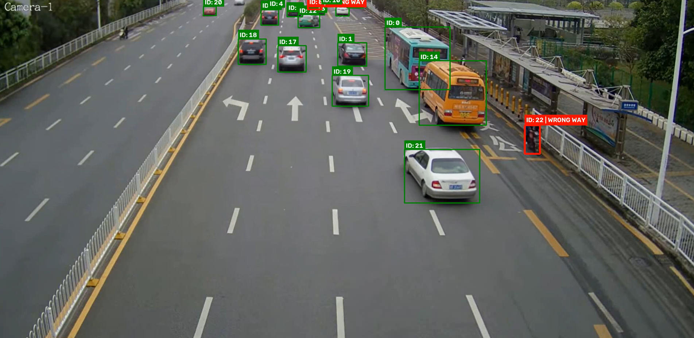
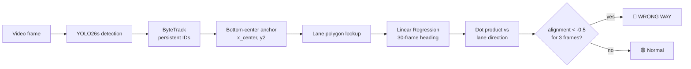
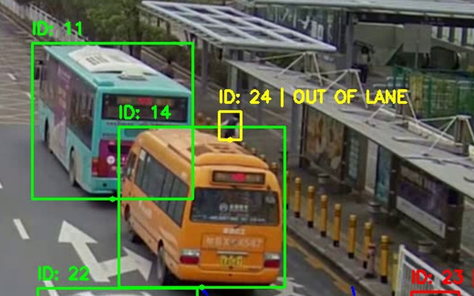
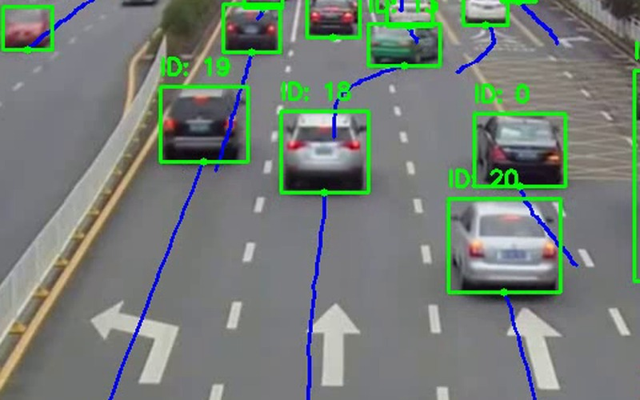
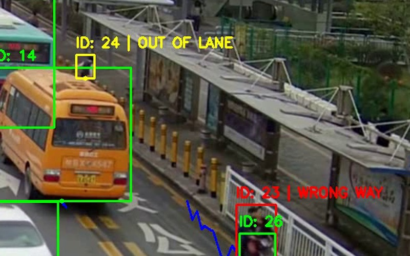
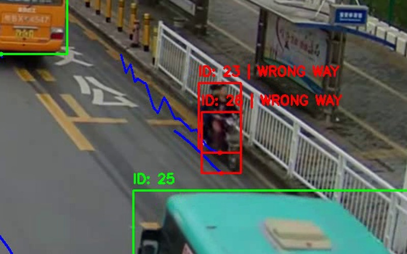

# Wrong-Way Vehicle Detection

Detects vehicles driving **against the permitted direction of their lane** in fixed-camera CCTV footage, using **YOLO26** detection, **ByteTrack** tracking and a custom lane-aware direction engine.

For every tracked vehicle, the pipeline asks one question per frame: *is this vehicle moving opposite to the direction its current lane permits?* A violation is raised only after the answer stays "yes" for several consecutive frames, which keeps false alerts low.


> **Note:** The diagram illustrates the V1 concept. The current pipeline has been upgraded to YOLO26, ByteTrack, and uses bottom-center Linear Regression.

## 🎬 Demo

10-second, two-way CCTV clip with one wrong-way two-wheeler. Green = normal, yellow = outside every lane, red = wrong-way, dark-blue line = track trail.


[](demo/output.mp4)



## 🔍 How It Works



| Stage                    | What happens                                                                                                                             |
| ------------------------ | ---------------------------------------------------------------------------------------------------------------------------------------- |
| **1. Detect**      | YOLO26s runs at `imgsz=1280` so distant vehicles and small two-wheelers are still found (`confidence=0.1`, `iou=0.6`).             |
| **2. Track**       | ByteTrack keeps IDs stable through occlusions. Negative IDs (`-1`) from unconfirmed detections are dropped.                            |
| **3. Anchor**      | The bottom-center `(x_center, y2)` of each box approximates where the tires touch the road.                                            |
| **4. Lane lookup** | The anchor is tested against hand-annotated lane polygons (CVAT export, stored in `configs.yaml`).                                     |
| **5. Heading**     | A rolling 30-frame history of anchors is fitted with Linear Regression. The best-fit line gives a stable heading and ignores box jitter. |
| **6. Decide**      | The heading is compared with the lane's permitted direction. Alignment below `-0.5` for 3 consecutive frames raises a violation.       |

### Stage by stage

|                1 · Detection                |                2 · Tracking                |
| :------------------------------------------: | :------------------------------------------: |
|  |    |
|     YOLO26s boxes around every road user     | Persistent IDs and trails behind each anchor |

|                 3 · Lane lookup                 |                 4 · Wrong-way flag                 |
| :----------------------------------------------: | :--------------------------------------------------: |
|  |    |
|  Anchor outside all polygons →`OUT OF LANE`  | Red box and label after consecutive wrong-way frames |

### Reading the alignment score

`alignment = normalized(movement) · normalized(lane_direction)`

|  `alignment`  | Angle vs lane | Meaning                                         |
| :-------------: | :-----------: | ----------------------------------------------- |
| **+1.0** |      0°      | Moving exactly along the lane → ✅ correct     |
|       0.0       |     90°     | Perpendicular (e.g. crossing) → not flagged    |
|      −0.5      |     120°     | Exactly at the threshold                        |
| **−1.0** |     180°     | Moving exactly against the lane → 🚨 wrong-way |

## 🧠 Key Engineering Decisions

| Decision                                           | Why                                                                                                                                                                      |
| -------------------------------------------------- | ------------------------------------------------------------------------------------------------------------------------------------------------------------------------ |
| **Bottom-center anchor, not box centroid**   | The centroid let tall vehicles drift into the neighbouring lane. The tire contact point matches the road plane, and the same point is used for lane lookup and tracking. |
| **Linear Regression over a 30-frame buffer** | Comparing two points is sensitive to jitter. A best-fit line gives a robust heading and velocity.                                                                        |
| **ByteTrack replaced the centroid tracker**  | Keeps persistent IDs through occlusions and associates low-confidence boxes, so slow riders are not lost or re-ID'd.                                                     |
| **`imgsz=1280`, `confidence=0.1`**       | Favours recall for distant two-wheelers. Persistence checking filters the extra noise.                                                                                   |
| **Persistence gate (3 frames)**              | One noisy frame can never trigger an alert.                                                                                                                              |
| **`frame_skip: 3`**                        | YOLO runs on 1 of every 3 frames to speed up CPU processing, while the output video is still written at a smooth 30 fps.                                                 |
| **Per-run experiment folders**               | Each run saves to a timestamped folder in `backend/experiments/` for reproducibility. Heavy `.mp4` and `.xml` files are git-ignored.                               |

### Evolution: V1 → current

|             | V1                            | Current                                      |
| ----------- | ----------------------------- | -------------------------------------------- |
| Detector    | YOLOv5                        | **YOLO26s** (`yolo26s.pt`, 1280 px)  |
| Tracker     | Hungarian centroid tracker    | **ByteTrack**                          |
| Anchor      | Box centroid → bottom-center | **Bottom-center**                      |
| Direction   | Mean of first / last 3 points | **Linear Regression, 30-frame buffer** |
| Persistence | 5 frames                      | **3 frames**                           |

### 🐞 Lessons from debugging

| Problem                                 | Root cause                                                                                                          | Fix                                                                      |
| --------------------------------------- | ------------------------------------------------------------------------------------------------------------------- | ------------------------------------------------------------------------ |
| Wrong-way two-wheeler drawn green       | Rider moved ~2 px/frame, so a high `min_displacement` (60) marked it stationary and the direction check never ran | Lowered the threshold to 15 px; parked cars are still filtered           |
| Lane membership flickered at lane edges | Anchor crossed the polygon edge by 1–3 px and the violation counter reset on every lane-less frame                 | Extended the lane polygon; sticky lane assignment is a planned next step |
| Vehicle matched to the wrong lane       | Box centre overlapped the adjacent lane                                                                             | Moved the anchor to bottom-center `(x_center, y2)`                     |

The debug overlay (`debug.mp4` + `debug.csv`) was built to trace exactly these cases frame by frame.

## 📁 Project Structure

```text
wrong_way_detection/
├── backend/
│   ├── configs/configs.yaml
│   ├── experiments/ (git-ignored)
│   ├── scripts/run_pipeline.py
│   ├── src/
│   │   ├── detection/vehicle_detector.py
│   │   ├── tracking/vehicle_tracker.py
│   │   ├── utils/helper.py
│   │   └── wrong_way/
│   │       ├── lane_regions.py
│   │       ├── wrong_way_detector.py
│   │       └── visualize_debug.py
│   ├── pytest.ini
│   └── requirements.txt
```

## ⚙️ Setup

```powershell
git clone https://github.com/jhilpatel06/TrafficRulesViolationDetection.git
cd wrong_way_detection
py -m venv .venv
.venv\Scripts\Activate
pip install -r requirements.txt
```

1. Put your footage in the input path set in `backend/configs/configs.yaml`.
2. Make sure `yolo26s.pt` is available (Ultralytics can download it on first run).
3. Annotate lane polygons in [CVAT](https://www.cvat.ai/) and paste their coordinates, plus each lane's permitted direction, into `configs.yaml`.

## ▶️ Run

```powershell
cd backend
python -W ignore -m scripts.run_pipeline
```

Run the tests with `pytest` from the `backend/` folder.

### Outputs generated per run

Saved in a timestamped folder under `backend/experiments/`:

| File             | Purpose                                                                    |
| ---------------- | -------------------------------------------------------------------------- |
| `output.mp4`   | Annotated video: green / red boxes                                         |
| `debug.mp4`    | Overlay with lane polygons and track IDs with dark-blue trajectory trails |
| `debug.csv`    | Frame-by-frame track data (bbox, anchor, lane membership)                  |
| `results.json` | Experiment summary                                                         |

> **Tip:** `.mp4` files are git-ignored. To keep the demo video in the repo, add `!demo/*.mp4` to `.gitignore`.

## 🚀 Future Improvements

1. **Sticky lane assignment**: hold the last lane for 1–2 frames to stop edge flicker.
2. **Merge split tracks**: re-identify the same rider after a long occlusion with appearance features.
3. **Adaptive `min_displacement`**: derive it from camera FPS and vehicle size instead of fixed pixels.
4. **Class-aware thresholds**: react faster for cars and buses, use a longer window for two-wheelers and pedestrians.

## Credits

- Detection and tracking foundations: Rahman, Ami & Ullah, *A Real-Time Wrong-Way Vehicle Detection Based on YOLO and Centroid Tracking*, IEEE TENSYMP 2020 ([repo](https://github.com/zillur01/wrong-way-vehicle-detection)). All lane and direction logic in this project is new.
- [Ultralytics YOLO](https://github.com/ultralytics/ultralytics) for detection.
- ByteTrack: Zhang et al., *ByteTrack: Multi-Object Tracking by Associating Every Detection Box*, ECCV 2022.

## Author

Pallavi Raghuvanshi
