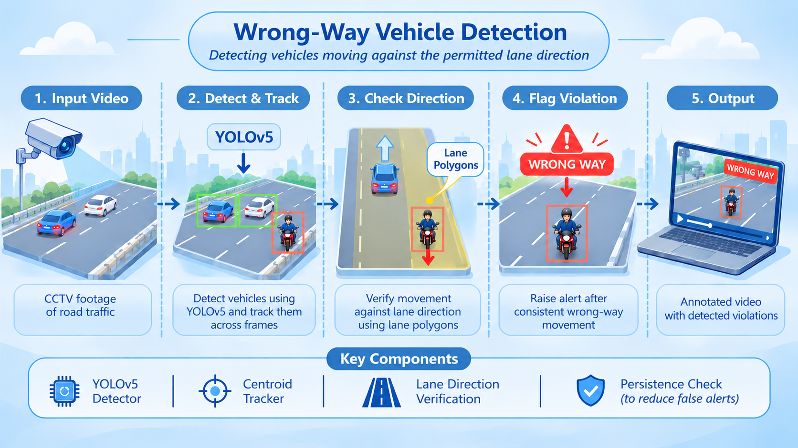

# Wrong-Way Vehicle Detection

## Project Brief

Detects wrong-way driving in CCTV footage by combining YOLOv5 object detection, a centroid-based multi-object tracker, and lane-direction verification against hand-annotated lane polygons.

For each tracked vehicle, the pipeline answers one question per frame: *is this vehicle moving opposite to the direction its current lane permits?* A violation is raised only after the condition persists for several consecutive frames.

Confirmed wrong-way vehicles are drawn in red in the output video. Every run writes its artifacts and a full configuration snapshot to `backend/experiments/` for reproducibility.



> generated by ChatGPT

---

## Project Structure

```
wrong_way_detection/
├── README.md
├── image/
└── backend/
   ├── configs/
   │   └── configs.yaml                  # lane polygons, thresholds, paths
   ├── data/
   │   ├── annotations.xml               # CVAT export (lane polygons)
   │   └── videos/                       # input footage
   ├── experiments/                      # per-run outputs + config log
   ├── scripts/
   │   ├── run_pipeline.py               # main entrypoint
   │   └── update_lane_polygons.py       # sync config ↔ XML
   ├── src/
   │   ├── detection/vehicle_detector.py # YOLOv5 wrapper
   │   ├── tracking/vehicle_tracker.py   # Hungarian centroid tracker
   │   ├── utils/helper.py               # config loader
   │   └── wrong_way/
   │       ├── lane_regions.py           # point-in-polygon tests
   │       ├── wrong_way_detector.py     # direction + persistence check
   │       └── visualize_debug.py        # diagnostic overlay
   └── yolov5/                           # external dependency
```

### Setup

Run these commands from the directory containing `wrong_way_detection`:

```powershell
cd wrong_way_detection
py -m venv .venv
.venv\Scripts\Activate
pip install -r requirements.txt
```

Copy the `yolov5/` folder and `my_coco.pt` into `wrong_way_detection/backend/yolov5/` (from [zillur01/wrong-way-vehicle-detection](https://github.com/zillur01/wrong-way-vehicle-detection)).

### Run

From the directory containing `wrong_way_detection`, run:

```powershell
cd wrong_way_detection\backend
python -W ignore -m scripts.run_pipeline
```

### Outputs per run (`backend/experiments/`)

| File                        | Purpose                                                          |
| --------------------------- | ---------------------------------------------------------------- |
| `<exp_name>.mp4`          | Production video (green / red boxes)                             |
| `<exp_name>_debug.mp4`    | Debug overlay (polygons, centroids, anchors, IN/OUT labels)      |
| `<exp_name>_debug.csv`    | Per-frame track record (bbox, centroid, anchor, lane membership) |
| `_experiment_configs.csv` | One row per run — full config snapshot                          |

---

## Workflow

```
                Video frame
                     │
                     ▼
      ┌──────────────────────────────┐
      │  YOLOv5 detector             │  ──> detections: bbox, class, conf
      └──────────────────────────────┘
                     │
                     ▼
      ┌──────────────────────────────┐
      │  Centroid tracker (Hungarian)│  ──> stable track_id + rolling history
      └──────────────────────────────┘
                     │
       ┌─────────────┴──────────────┐
       ▼                            ▼
┌───────────────┐          ┌────────────────────┐
│ Lane lookup   │          │ Wrong-way detector │
│ (bottom-ctr   │ ───────► │  • window average  │
│  in polygon?) │          │  • displacement    │
└───────────────┘          │  • dot product     │
                           │  • persistence     │
                           └────────────────────┘
                                    │
                                    ▼
                          WRONG_WAY track IDs
                                    │
                                    ▼
                      ┌──────────────────────────┐
                      │ Annotate + write video   │
                      │ + dump CSV & experiment  │
                      └──────────────────────────┘
```

**Core logic per track per frame:**

1. Take last `history_window` centroids.
2. `start = mean(first 3)`, `end = mean(last 3)` → `movement = end − start`.
3. If `|movement| < min_displacement` → stationary, reset counter, skip.
4. `alignment = normalized(movement) · normalized(lane_direction)`.
5. If `alignment < direction_threshold` for `required_consecutive_frames` in a row → flag as wrong-way.

**Dot-product interpretation:**

| `alignment` | angle vs lane | meaning                         |
| ------------- | ------------- | ------------------------------- |
| `+1.0`      | 0°           | perfectly along → correct      |
| `0.0`       | 90°          | perpendicular → not flagged    |
| `-0.5`      | 120°         | exactly at threshold            |
| `-1.0`      | 180°         | perfectly opposite → wrong-way |

---

## Reference Model

- **Detector** — off-the-shelf YOLOv5 (`my_coco.pt`) from [`zillur01/wrong-way-vehicle-detection`](https://github.com/zillur01/wrong-way-vehicle-detection). Runs on all COCO classes (`car`, `bus`, `truck`, `motorcycle`, `person`) so slow two-wheeler riders are not silently dropped when classified as `person`.
- **Tracker** — custom Hungarian centroid tracker (`vehicle_tracker.py`). Matches detections to existing tracks via `scipy.optimize.linear_sum_assignment` on centroid distance, with `max_distance` and `max_disappeared` cutoffs. Maintains a rolling centroid history per track.
- **Upstream repo limitation** — that project has no lane concept at all. Its "wrong-way" logic compares one-frame centroid deltas against a fixed horizontal ROI band. All lane and direction logic here is **newly implemented** on top of its detector and tracker.

---

## Recent Outputs

### 10-second CCTV clip, two lanes, one wrong-way two-wheeler

| Parameter                       | Value                 | Effect                                                          |
| ------------------------------- | --------------------- | --------------------------------------------------------------- |
| `history_window`              | 10                    | ~7-frame effective span (3-frame averaging at each end)         |
| `min_displacement`            | **15** (was 60) | Slow riders pass the "moving" check; parked cars still filtered |
| `direction_threshold`         | -0.5                  | 120° off permitted direction                                   |
| `required_consecutive_frames` | 5                     | Persistence gate                                                |

### Results

- **Cars and buses** moving along the permitted direction correctly pass through with green boxes.
- **Two-wheeler in right lane** (track 24, later re-ID'd as 33) — previously green, now flagged **WRONG WAY** after lowering `min_displacement` from 60 to 15.
- **Debug overlay** confirms lane polygon membership, bottom-center anchors, and direction arrows for every track — the two-wheeler's anchor stays inside the right-lane polygon across all frames.
- **`_debug.csv`** lets you trace any track ID across frames and see exactly whether it was (`box:IN`, `anc:IN`), outside every polygon (`OUT`), or flickering.

---

## Problems Faced and Debugging

### 1. Wrong-way two-wheeler detected as normal (track 47 / 24 / 33)

**Symptom:** The two-wheeler moving opposite to the right lane was drawn green.

**Root cause:** Two separate issues.

- The rider is slow (~2 px/frame). `min_displacement = 60` treated it as stationary on every frame, so the direction check was never reached. The rider was missing from the CSV entirely in the first run.
- YOLO classified the rider as `person`, not `motorcycle` — but that did not matter because the detector is class-agnostic.

**Fix:** Lowered `min_displacement` from `60` → `15` in `configs.yaml`. Parked cars (0–3 px over the window) are still filtered; slow movers now pass.

**Debugging tool:** `visualize_debug.py` — added polygon outlines, bottom-center anchors, and per-track `IN/OUT` labels so lane membership could be inspected frame by frame. Also emits `_debug_anchors.csv` for offline tracing.

### 2. Lane membership flicker on edge-of-lane vehicles

**Symptom:** Tracks near the bottom of the image oscillated `IN` ↔ `OUT` as `y2` crossed the polygon edge by 1–3 px.

**Root cause:** `update()` reset `violation_counts = 0` on every `lane is None` frame. A genuinely wrong-way vehicle could never reach `required_consecutive_frames = 5`.

**Fix:** Extend right-lane polygon to include more of the right border. **Remaining work:** sticky lane assignment for 1–2 frames.

### 3. Tracker centroid vs road contact point

**Symptom:** Cars whose upper box overlapped an adjacent lane were being associated with the wrong lane.

**Fix:** Changed `_get_centroid()` in `vehicle_tracker.py` from geometric center to **bottom-center** `(x_center, y2)`. This also aligns with the lane-lookup point in `wrong_way_detector.py`, removing a source of disagreement between detection and lane test.

---

## Future Improvements

1. **Trajectory direction estimator upgrade** — replace first/last-of-window averaging with a least-squares fit or EMA-smoothed finite difference. Current method reacts slowly to sudden direction changes and is sensitive to how the window is sampled.
2. **Merge split tracks** — track 24 → 33 is the same physical rider. Incorporate appearance features or a short coasting window (`max_disappeared` 10 → 20) to reduce split IDs.
3. **Adaptive `min_displacement`** — derive the threshold from camera FPS and known vehicle lengths instead of hardcoding pixels, so the pipeline is portable across resolutions.
4. **Class-aware thresholds** — allow faster reactions for vehicles (cars, buses) while giving two-wheelers and pedestrians a longer window, instead of one global `min_displacement`.
